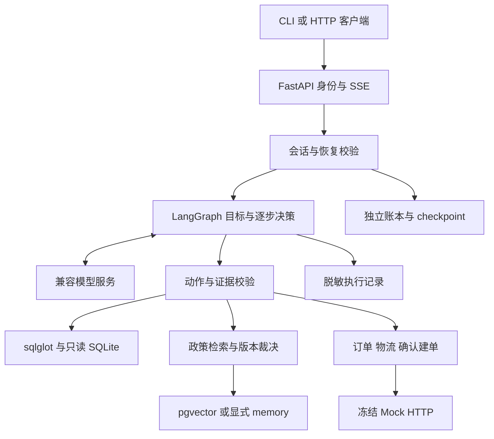

# 智能售后 LangGraph Agent

基于订单、物流和政策回答售后问题，支持只读 SQL、引用、缺参澄清和确认后建单。Python 3.11+；容器使用 3.12，本机验证使用 3.14。

## 目录与数据

| 目录 | 内容 |
|---|---|
| `agent/`、`api/` | LangGraph、工具、检索、守卫、FastAPI SSE 与运行账本 |
| `eval/` | `golden_dataset.jsonl`（36 条）、运行器、Oracle、`eval.py`、`报告.md`、当前评分结果 |
| `knowledge/` | 30 篇政策（5 个旧版本）、`ingest.py` 和来源校验 |
| `database/` | `schema.sql`、已装载种子的 `ecommerce.db`、字典和生成器；200 订单、125 物流、24 商品 |
| `docker/` | Dockerfile 与 Compose，包含 Agent、Mock、pgvector 三服务 |
| `docs/` | 当前部署、架构、交付、风险、验证说明和实际截图 |
| `data/c004-r01/baseline/` | 运行必需的完整冻结参考包，含订单、50 条合成对话及原政策/数据库/评测快照 |
| `mock/`、`mock_service/`、`mock_server.py` | 冻结业务 HTTP 服务与故障配置 |
| `tests/`、`dev/` | 回归与演示工具 |

默认部署从根目录 `knowledge/`、`database/` 加载，默认基线评测读取 `eval/golden_dataset.jsonl`；三者按冻结 manifest 核验摘要。原基线是 Mock、Oracle 和完整快照校验的运行依赖，不能删减内部文件。全部业务样本为候选人合成数据；参考日 `2026-11-15`、时区 `Asia/Shanghai`。金额底层按整数分保存，用户回答以人民币元显示。

## 安装与验证

所有命令从仓库根目录执行。新环境复制 `.env.example` 为私有 `.env` 并补齐配置；已有 `.env` 保留。

```powershell
python -m venv .venv
.venv\Scripts\python -m pip install -r requirements.lock
.venv\Scripts\python -m mock.verify_freeze
.venv\Scripts\python -m pytest tests -q
```

## pgvector 容器部署

默认向量后端是 **pgvector**，实际容器和 pgvector 正向验收尚未完成。以下为待目标环境验证的流程。`.env` 需配置模型/embedding、向量维度、`POSTGRES_PASSWORD` 和 `BUSINESS_SERVICE_TOKEN`；合成演示另填 `DEMO_MODE=true` 与私有 `AUTH_TOKENS`（Bearer 到 `eval-u01` 等合成用户的 JSON 映射）。

```powershell
docker compose --env-file .env -f docker/docker-compose.yml up -d --build vector business
docker compose --env-file .env -f docker/docker-compose.yml build api
docker compose --env-file .env -f docker/docker-compose.yml run --rm api python -m knowledge.ingest --backend pgvector
docker compose --env-file .env -f docker/docker-compose.yml up -d api
Invoke-RestMethod 'http://127.0.0.1:8080/health?mode=ready'
```

build context 为仓库根目录，Dockerfile 为 `docker/Dockerfile`；环境文件和基线挂载相对 Compose 文件指向上一级。宿主端口为 Agent `8080`、Mock `8090`、pgvector `55435`。入库会调用真实 embedding。详细部署、离线准备及资源估算见[部署手册](docs/部署手册.md)，接口和故障处理见[FAQ](docs/部署与FAQ.md)。

## 本机 memory 演示

以下显式选择 memory，仍调用真实模型和 embedding，不能作为 pgvector 验收证据。分别在两个窗口启动，已有同端口服务时不要重复运行：

```powershell
.venv\Scripts\python -m dev.demo mock
.venv\Scripts\python -m dev.demo api --vector memory
```

第三个窗口发送请求：

```powershell
.venv\Scripts\python -X utf8 -m dev.demo chat "查询订单 EVAL-002 的状态和金额。"
```

临时凭据、账本和 Trace 位于私有 `runtime/local-demo/`，不随仓库交付。更多操作见[演示清单](docs/演示与交付清单.md)。

## 可重复评测

受控模式不调用外部模型，自行启动临时 Agent 和 Mock，实际执行 HTTP、检索、SQL、Graph、确认和账本。每次使用新的输出目录。

```powershell
.venv\Scripts\python -m eval.runner --profile controlled --database-dir database --knowledge-path knowledge --output runtime/golden-run
.venv\Scripts\python -m eval.eval --root data/c004-r01/baseline --contract mvp-agent-v2 --observations runtime/golden-run/observations.json --output runtime/golden-run/evaluation
```

运行器和评分器默认读取 `eval/golden_dataset.jsonl`，可用 `--cases-file` 显式指定同一冻结版本文件；缺失或摘要不一致报 `EVAL_SNAPSHOT_MISMATCH`。选择其他 `--root` 数据包时默认使用该包的评测快照。运行器退出成功只代表观测已采集，是否通过以独立评分报告为准。

## 架构与选型



LangGraph 管理多轮状态、中断与恢复；项目代码实现授权和证据校验。SQLite 便于复现合成业务，sqlglot 与只读连接限制查询。pgvector 是独立容器向量库，memory 用于显式本机机制演示。详见[架构设计](docs/架构设计.md)。

## 指标与已知问题

| 项目 | 当前结果 |
|---|---|
| 本轮交付预览 pytest | 674 passed / 13 warnings / 181.97 s（干净交付副本） |
| 完整受控 Golden | 34 PASS / 2 FAIL / 0 NOT_RUN；工具轨迹 36/36，安全门禁 FAIL |
| 独立语义 / pgvector / Docker | NOT_RUN |

[评测报告](eval/报告.md)和[验证记录](docs/reports/交付验证记录.md)明确执行范围。既有 GOLD-11 聚合口径披露和 GOLD-26 契约失败保留；本轮不修改预期。全量真实模型、独立语义、pgvector/容器、离线运行、显存/QPS 与报价仍待验证。最终答案整段 SSE 发送，执行说明和工具结果逐步发送。三表缺少退款流水和商品订单明细；图表、Redis 和长会话摘要压缩未交付。

详见[需求追踪](docs/需求追踪矩阵.md)、[风险清单](docs/风险与待确认事项.md)、[交付清单](docs/交付清单.md)。招聘方已确认免交录屏。历史评审、计划、内部协作、实际 `.env`、运行凭据与私有 Trace 不交付。
